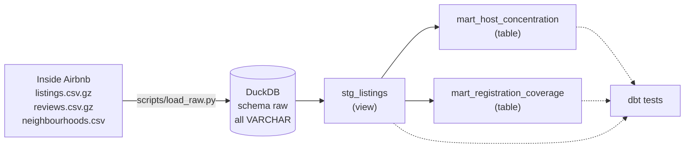

# Berlin Short-Term Rentals: an analytics pipeline with dbt + DuckDB


An end-to-end analytics engineering project built on public data from [Inside Airbnb](https://insideairbnb.com/get-the-data/) (Berlin scrape of 2026-09-19, licensed [CC BY 4.0](http://creativecommons.org/licenses/by/4.0/)). It turns the raw listing files into tested, documented tables that answer two questions: **who supplies short-term rentals in each Berlin district, and how many listings show a valid Berlin registration number?**

> **Status:** ingestion, staging and the first mart are done and tested. The second mart is built and is getting its tests and documentation. See [Roadmap](#roadmap).

---

## TL;DR

- **What:** a dbt project that loads about 12,400 Berlin Airbnb listings (plus about 700,000 reviews) into DuckDB, cleans the listings in a staging layer, and aggregates them into business-facing marts by district.
- **Stack:** Python (ingestion), DuckDB (warehouse), dbt Core (transformation, testing, documentation), SQL.
- **Skills shown:** layered modelling (raw → staging → marts), generic and custom data tests, rule-based classification of messy free-text data, privacy-aware design, and written-down modelling decisions.
- **Headline finding:** large hosts (10+ listings) are about 1% of hosts but run about 16% of listings. Only 3% of their listings show a valid-format registration number, against 46% for single-listing hosts.

---

## Business context

Since 1 August 2018, Berlin's *Zweckentfremdungsverbot* (the law against using housing for other purposes) requires hosts who offer a flat as a holiday rental to show a **registration number** in their listing, for example on online platforms. The district office (*Bezirksamt*) issues the number.

The Inside Airbnb data has a free-text `license` field for each listing. This project uses it to answer:

1. **Host concentration:** in each district, what share of listings belongs to single-listing hosts and what share to large hosts?
2. **Registration coverage:** in each district, what share of listings shows a valid-format registration number, and what do the others show instead (nothing, an exemption, company details, placeholders)?

Both questions are reported at **district (Bezirk) level** (12 districts).

---

## Key findings (snapshot 2026-09-19)

**Who supplies the listings**

| Host size band | Hosts | Listings | Share of listings |
|---|---:|---:|---:|
| 1 listing | 6,630 | 6,630 | 53.6% |
| 2–4 listings | 985 | 2,393 | 19.3% |
| 5–9 listings | 223 | 1,416 | 11.4% |
| 10+ listings | 85 | 1,937 | 15.7% |

**What the license field contains**

| License type | Listings | Share |
|---|---:|---:|
| Valid-format registration number | 4,278 | 34.6% |
| Missing | 4,040 | 32.6% |
| Legal entity details (company template) | 2,351 | 19.0% |
| Private individual details (name template) | 1,591 | 12.9% |
| Exempt | 75 | 0.6% |
| Other (placeholders, typos) | 41 | 0.3% |

**What stands out**

- **Registration coverage falls as host size grows:** 46% of single-listing hosts' listings show a valid-format number, against 39% (2–4), 17% (5–9) and **3% (10+)**. Of the 1,937 listings from 10+ hosts, 1,110 (57%) show legal entity details instead.
- **The central districts have both the most large-host supply and the lowest coverage.** Mitte has 22.5% of listings from 10+ hosts and 28.8% coverage. Charlottenburg-Wilmersdorf has 20.3% and 28.4%. Marzahn-Hellersdorf has the highest coverage, at 49.1%.

---

## Architecture



| Layer | Model | Materialization | Grain | Purpose |
|---|---|---|---|---|
| Raw | `raw.listings`, `raw.reviews`, `raw.neighbourhoods` | table (Python loader) | one row per file row | Exact copy of the source files, every column `VARCHAR`, plus `_source_file`, `_scrape_date`, `_loaded_at` metadata |
| Staging | `stg_listings` | view | one row per listing | Casts types, renames columns, and derives `host_size_band` and `license_type` |
| Marts | `mart_host_concentration` | table | one row per district × host size band | Listings and share of district per host size band |
| Marts | `mart_registration_coverage` | table | one row per district × license type | Listings and share of district per license type |

**Why this shape:**
- **Raw is all text.** Loading everything as `VARCHAR` keeps raw exactly as the file had it. Every type cast happens in staging, where dbt can see and test it.
- **Business rules live in staging, marts only aggregate.** "What counts as a valid registration" is defined once, so both marts use the same definition.
- **No facts and dimensions.** Two aggregate tables answer the questions, so there is no dimensional layer.

---

## Data quality and testing

`dbt build` runs every model and its tests together, in dependency order.

**Generic tests (YAML)**
- `unique` + `not_null` on the `stg_listings` primary key.
- `accepted_values` on every derived category (`district`, `host_size_band`, `license_type`). If a new district spelling or a new category appears in a future snapshot, the build fails instead of quietly producing a wrong report.

**Custom (singular) tests in [`tests/`](tests/)**

| Test | What it protects against |
|---|---|
| `assert_host_concentration_unique_grain` | Duplicate district × band rows, for example from a bad join or group-by |
| `assert_host_concentration_shares_sum_to_100` | Percentages that don't add up per district (tolerance 0.05 for rounding) |
| `assert_host_concentration_matches_staging` | Listings lost or double-counted between staging and the mart |

---

## Modelling decisions

- **Reporting grain:** district (12), not neighbourhood (137 neighbourhoods have listings).
- **Host size bands:** 1, 2–4, 5–9, 10+ listings per host.
- **Valid registration:** only `license_type = 'registration number'` counts as valid. `legal entity`, `private individual`, `other` and `missing` do not. `exempt` (75 listings) is not counted as valid either, because there is no number to check.
- **Strict format rule:** a value counts as a registration number only if the *whole* value matches the Berlin format `NN/A/AA/NNNNNN-NN` (anchored regex, case-insensitive). This rejects typos such as `01-Z-NA-OO4O70-15` and all-digit placeholders such as `12/3/45/678910-11` (both go to `other`).
- **Classification order is explicit:** missing → exempt → registration number → legal entity → private individual → other. The first match wins, so every listing lands in exactly one category.
- **Privacy by design:** the raw `license` text is read in staging to classify it but is **never selected**, because it can contain names of private individuals.

---

## Data notes and limitations

- **A format check is not a verification.** `registration number` means the value *looks* like a Berlin registration number. It is not checked against the official register.
- **Edge case:** 4 listings (2 `legal entity`, 2 `private individual`) contain a registration-format number *inside* template text. They are counted as not valid because the rule needs the whole value to be the number. That is too few to visibly move any district share.
- **Host counts were checked:** `calculated_host_listings_count` matches the number of rows per `host_id` for every host (0 mismatches), so it counts Berlin listings only and is safe to use for the size bands.
- **Single snapshot:** all numbers come from the 2026-09-19 scrape, so this is a point-in-time picture, not a trend.

---

## How to run it

No database server or credentials needed, because DuckDB is a single local file. Tested on macOS (zsh) with Python 3.

```bash
git clone <this repo> && cd airbnb-berlin-dbt
python3 -m venv .venv && source .venv/bin/activate
python -m pip install -r requirements.txt
cp profiles.yml.example profiles.yml   # local dbt profile, gitignored

# 1. Download the source data
mkdir -p data/raw
D=https://data.insideairbnb.com/germany/be/berlin/2026-09-19
curl -L -o data/raw/listings.csv.gz    $D/data/listings.csv.gz
curl -L -o data/raw/reviews.csv.gz     $D/data/reviews.csv.gz
curl -L -o data/raw/neighbourhoods.csv $D/visualisations/neighbourhoods.csv

# 2. Load raw files into DuckDB (creates airbnb_berlin.duckdb, schema `raw`)
python scripts/load_raw.py

# 3. Build and test all models (run dbt from the repo root)
dbt debug
dbt build

# 4. Browse the documentation and lineage graph
dbt docs generate && dbt docs serve
```

---

## Project structure

```
scripts/load_raw.py              raw files -> DuckDB schema `raw` (all VARCHAR + metadata columns)
models/staging/airbnb/           source definitions + stg_listings (views)
models/marts/                    business-facing aggregates (tables)
tests/                           custom singular tests
profiles.yml.example             DuckDB connection template (copy to profiles.yml)
requirements.txt                 pinned dbt-core, dbt-duckdb, duckdb
requirements-dev.txt             optional exploration tools (JupyterLab, pandas)
```

---

## Roadmap

- [x] Raw ingestion with load metadata
- [x] `stg_listings` with derived host size band and license type
- [x] `mart_host_concentration` with generic and singular tests
- [ ] `mart_registration_coverage`: add YAML documentation and tests
- [ ] Stage `reviews` (`stg_reviews`) to add an activity signal (recently reviewed vs. dormant listings)
- [ ] CI with GitHub Actions: run `dbt build` on every pull request
- [ ] Load several snapshots to track coverage over time (incremental models or snapshots)
